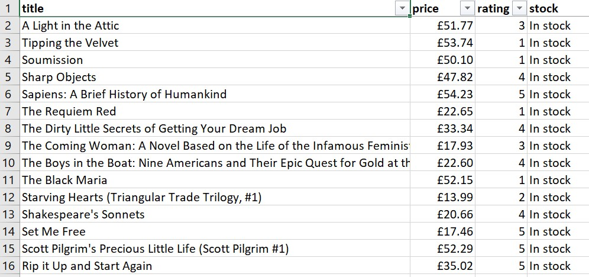
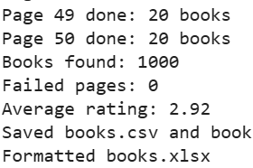

# Books Scraper

Python web scraper that collects all 1,000 books (title, price, rating, stock) from [books.toscrape.com](https://books.toscrape.com) and delivers a clean, formatted Excel file.

## Features

- Scrapes all 50 pages automatically (pagination)
- 4 fields per book: title, price, star rating (1-5), stock status
- Clean data: prices and ratings saved as numbers
- Retries with delays; failed pages are logged and skipped
- Polite scraping with a delay between requests
- Output: CSV and formatted Excel (bold header, £ prices, filters, frozen header)
- Bonus: JavaScript-page scraper with Playwright (`examples/js_quotes.py`)

## Output





## How to run

```
python -m venv .venv
.venv\Scripts\Activate.ps1
pip install -r requirements.txt
python scraper.py
```

For the Playwright example, run once: `python -m playwright install chromium`

## Project structure

```
scraper.py          main scraper
books.csv / .xlsx   sample output (1,000 books)
examples/           JavaScript scraper (Playwright)
practice/           learning files
screenshots/        images used in this README
```

## Tech

Python 3.13 • requests • BeautifulSoup • pandas • openpyxl • Playwright

## Note

books.toscrape.com is a practice website made for learning web scraping.